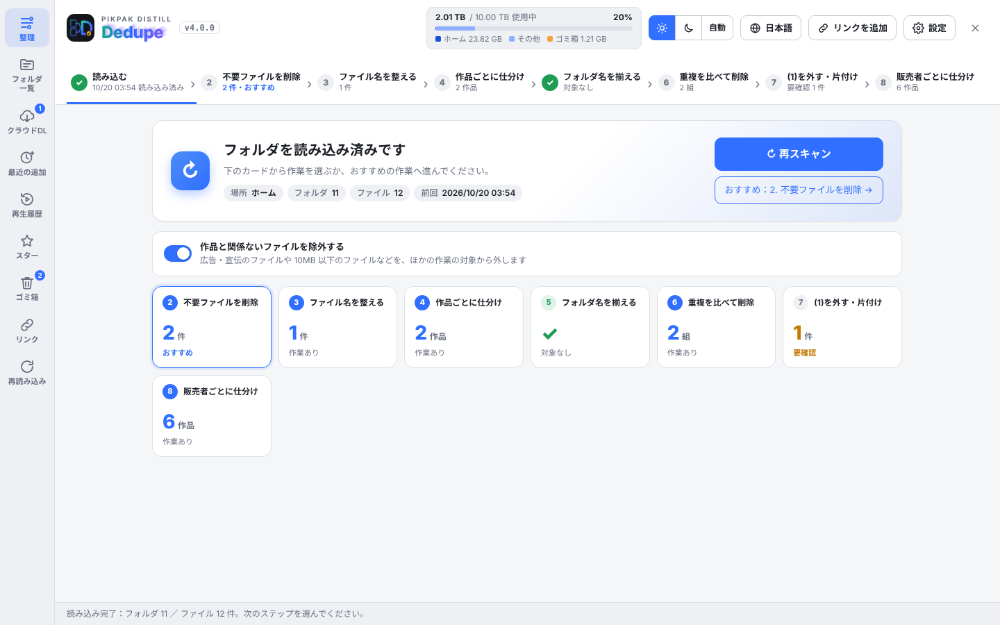
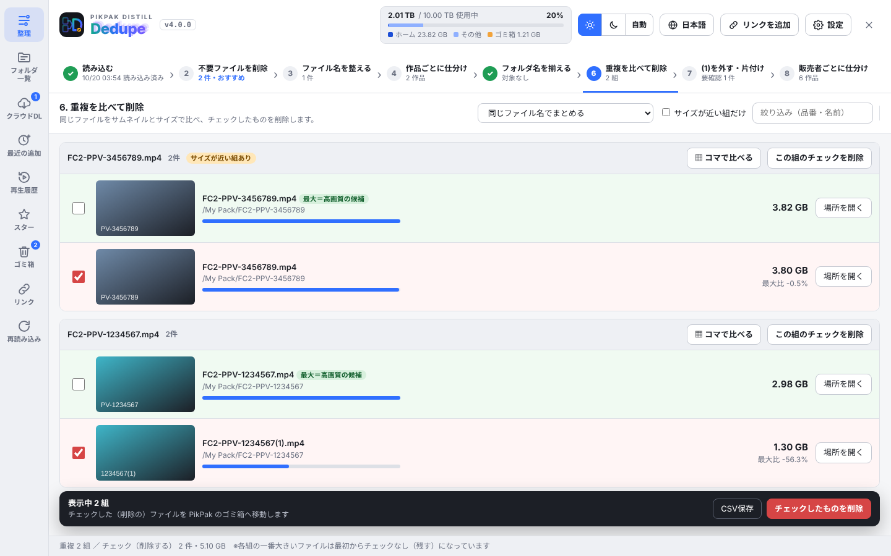
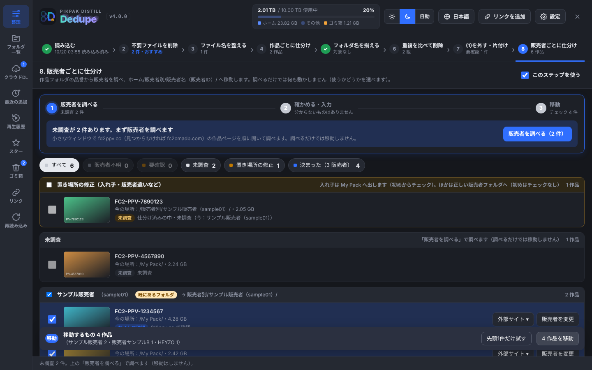
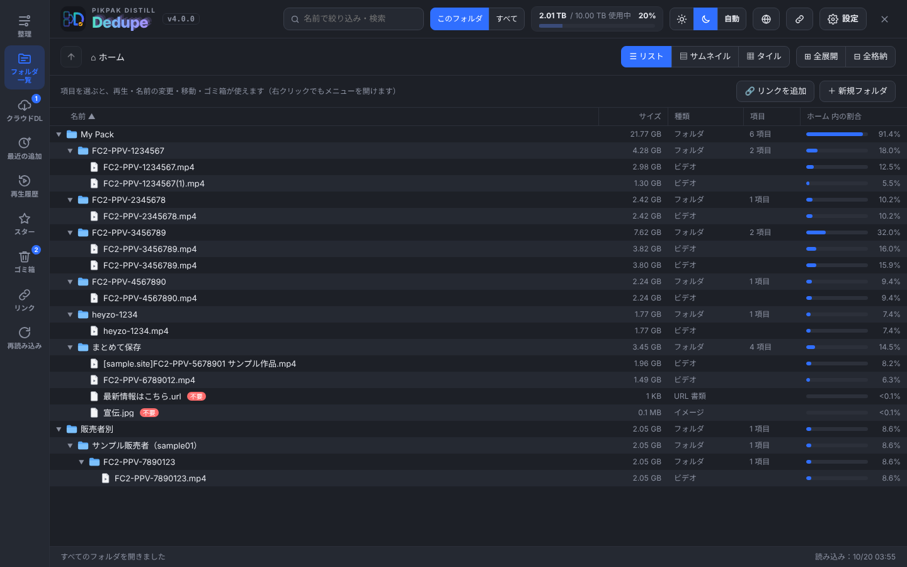
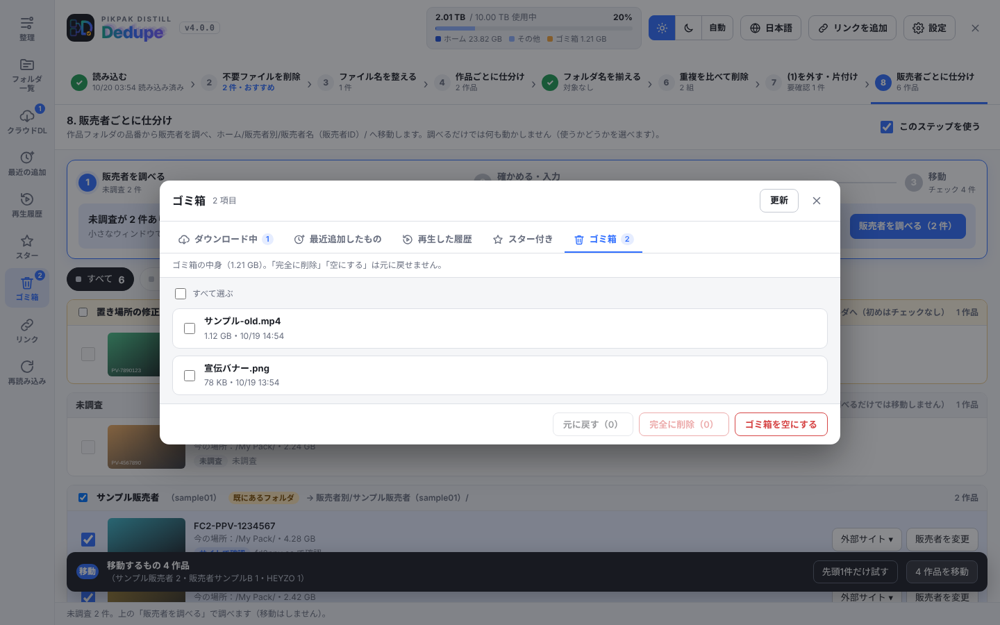

<p align="center">
  
</p>

<h1 align="center">PikPak Distill – Dedupe</h1>

<p align="center">
  PikPak の重複ファイルを見比べて整理し、作品ごと・販売者ごとに仕分けるツール<br>
  （ブラウザのユーザースクリプト／Mac アプリ）<br>
  <sub>by Noel Labs</sub>
</p>

<p align="center">
  <a href="https://raw.githubusercontent.com/Noel-Labs39/pikpak-distill/main/pikpak-distill.user.js"><b>▶ インストール</b></a>
  ・
  <a href="LICENSE">MIT License</a>
</p>



| 重複を比べて削除 | 販売者ごとに仕分け |
| --- | --- |
|  |  |
| **フォルダ一覧** | **左メニュー（ゴミ箱など）** |
|  |  |

<sub>画面はサンプルのファイル名で作ったテスト用の画面です。</sub>

## できること

| 機能 | 内容 |
| --- | --- |
| 不要ファイルの削除 | 広告・宣伝のファイルや 10MB 以下のファイルなど、作品と関係ないものを見分けて削除します。オンの間は、ほかの機能の対象から外すので、広告ファイルの名前でフォルダが作られたりしません |
| 重複比較 | 開いているフォルダ以下をスキャンし、同じファイル名（または同じ品番）のファイルをグループ化。サムネイル・サイズ・場所を並べて表示します。各組で一番大きいファイルを「高画質の候補」として残し、それ以外にチェックを入れます |
| 削除 | チェックしたファイルを、一括または組ごとに削除。通常は PikPak のゴミ箱へ移動し、確認画面で「ゴミ箱を経由せず完全に削除」も選べます |
| 作品ごとに仕分け | 1つのフォルダに複数の作品が混在している場合、そのフォルダの中に品番フォルダを作って振り分けます。同名フォルダがあればそこへ移動し、同名ファイルがあれば `(1)` を付けます |
| フォルダ名の整合 | フォルダ名を中のファイル名（品番）に揃えます。同名フォルダがある場合は `(1)` を付けて重複を回避します |
| (1) を外す | 重複を削除したあと、不要になった `(1)` をフォルダ名・ファイル名から外します |
| 販売者ごとに仕分け | 作品フォルダ（`FC2-PPV-品番`・HEYZO・カリビアンコムなどの品番）の販売者を fd2ppv.cc・fc2cmadb.com で調べ、ホーム直下の `販売者別/販売者名（販売者ID）/` へまとめます |

| フォルダ一覧 | Finder やエクスプローラーのようにフォルダを開いて見られます。リスト・サムネイル・タイル表示、名前での検索（このフォルダ／すべて）、名前の変更・移動・ゴミ箱・新規フォルダ、ドラッグでの移動に対応 |
| 再生・コマ一覧 | その場で再生（画質の切り替え・速度・シークバーのプレビュー）。動画の途中のコマを並べて見比べ、1 枚の画像として保存できます |
| リンク・マグネットを追加 | 追加する前に中身と「もうあるか」を確かめてから、クラウドダウンロードに追加します |
| 解凍 | .zip・.rar・.7z を PikPak の上で解凍します。パスワードは記録しておき、次から自動で試します |
| 左メニュー | クラウドDL（ダウンロード中）・最近の追加・再生履歴・スター・ゴミ箱（元に戻す・完全に削除・空にする）を開けます |
| PikPak で同期 | 販売者の調査結果・重複の判断・設定を PikPak のフォルダに保存し、ほかのブラウザや Mac アプリと共有します |
| 新しい版のお知らせ | 新しいバージョンが出ると、画面の上に知らせます |

処理はすべて PikPak の API をバックグラウンドで呼び出して行うため、画面が切り替わることはありません（数百フォルダのスキャンでも 1 分程度）。

## インストール

1. ブラウザに [Tampermonkey](https://www.tampermonkey.net/) を入れます（Chrome / Brave / Edge / Firefox など）。
2. 上の **▶ インストール** を開き、Tampermonkey の画面で「インストール」を押します。
3. 以後、このリポジトリが更新されると Tampermonkey が自動で新しい版に更新します。

### Mac アプリ版

PikPak の画面をアプリの中で全画面表示し、Dedupe を組み込んだ Mac 用アプリです。スクリプトは起動のたびに最新版を読み込みます。

1. [最新のリリース](https://github.com/Noel-Labs39/pikpak-distill/releases/latest) から `Dedupe-macOS.zip` をダウンロードして展開し、`Dedupe.app` をアプリケーションフォルダに入れます
2. 初回はダブルクリックすると「開けません」と出るので「完了」で閉じ、「システム設定」→「プライバシーとセキュリティ」の下にある「このまま開く」を押します（Apple の公証を受けていないため）
3. 開けないときは、ターミナルで次を実行してから開きます

```
xattr -dr com.apple.quarantine /Applications/Dedupe.app
```

PikPak へのログインはアプリの中で行います。調査結果や設定は「PikPak で同期」をオンにすると、ブラウザ版と共有できます。

## 使い方

1. [PikPak](https://mypikpak.com/) にログインし、ホーム（または My Pack）を開きます。
2. 右下の **Dedupe** ボタンを押すと、メニューが開きます。「Dedupe スキャン」で読み込んでから 8 つのステップを左から順に進めるか、「フォルダ一覧」でファイルを見て操作できます。
3. 最初は**全画面**で開きます。PikPak の画面の上に重ねる**ポップアップ**で使いたいときは、設定の「表示」→「開き方」で切り替えます（ポップアップは見出しをつかんで移動、右下の角で大きさを変えられます）。

| ステップ | 内容 |
| --- | --- |
| 1. 読み込む | 開いているフォルダ以下を読み込みます。**ここを実行するまで、2〜8 は押せません**。「作品と関係ないファイルを除外する」をオンにしておくと、不要ファイルをほかのステップの対象から外します |
| 2. 不要ファイルを削除 | 広告・宣伝のファイルや 10MB 以下のファイルなど、作品と関係ないものを削除します（使うかどうか選べます）。字幕ファイルや、作品の可能性があるものは「要確認」としてチェックなしで表示します |
| 3. ファイル名を整える | FC2 のファイル名からサイト名・広告などを消して `FC2-PPV-品番(-番号)` にそろえます（使うかどうか選べます） |
| 4. 作品ごとに仕分け | 混在フォルダを品番ごとのフォルダに分けます |
| 5. フォルダ名を揃える | フォルダ名を中のファイル名（品番）に揃えます |
| 6. 重複を比べて削除 | チェックを確認して削除します（まずは「この組のチェックを削除」で 1 組だけ試すのがおすすめ） |
| 7. (1)を外す・片付け | 空フォルダをゴミ箱へ移し、`X/X/ファイル` のように同じ名前で入れ子になったフォルダを 1 つにまとめ、不要になった (1) を外します。削除後に「1. 読み込む」で読み込み直してから実行します |
| 8. 販売者ごとに仕分け | 「販売者を調べる」で、小さなウィンドウに作品ページを順に開き、販売者を調べます。FC2 は fd2ppv.cc で見つからなければ fc2cmadb.com でも調べます。FC2 以外（HEYZO・カリビアンコムなど）は fd2ppv.cc で品番を検索し、作品ページの「配信元」を販売者として扱います（調べるだけでは移動しません）。確認して「チェックしたものを移動」で `ホーム/販売者別/販売者名（販売者ID）/` へ移動します。分からないものは `販売者不明`、品番が複数あるものなどは `要確認` へ（初めはチェックなし）。販売者は手でも入力できます（使うかどうか選べます） |

- 「8. 販売者ごとに仕分け」は、ホームを開いて読み込むのがおすすめです（My Pack から読み込むと、移動した作品は読み込んだ範囲の外に出ます）。
  - 初めて「販売者を調べる」を押すと、ブラウザがポップアップの許可を求めることがあります。許可してからもう一度押してください。
  - 名前にサイト名がある品番（例：`121815_3315-1pon`・`122415-053-carib`・`010216_333-mura`・`heyzo-3769`）は、調べに行かずにその場で販売者（配信元）を決めます（「品番から判定」）。フォルダ名は英語名（例：`1pondo（1pon）`）です。
  - 日付型の品番だけでサイト名がないものは「販売者不明」になります。行の「外部サイト ▾」から JavDB・JavBus・Sukebei などで確かめて、行の入力欄に販売者名と ID を入れて保存できます。
  - 画面の上に「① 販売者を調べる → ② 確かめる・入力 → ③ 移動」と次にやることを表示し、移動ボタンは一覧の下に固定しています。
  - fd2ppv.cc・fc2cmadb.com の確認画面（Cloudflare）が出たら、開いた小さなウィンドウで確認を済ませてください。済むと自動で続きます。
  - 販売者ID は FC2 の販売者ページ `adult.contents.fc2.com/users/〇〇/` の 〇〇 と同じです。
- 各ステップには対象の件数が表示され、次にやるべきステップに「おすすめ」が付きます。対象がないステップは ✓ になります。
- 3・4・5・7 には「先頭1件だけ試す」があります。初めて使うときは 1 件だけ試してから一括実行してください。

### フォルダ一覧

画面左のメニューの **フォルダ一覧**（または右下のメニューの「フォルダ一覧」）で、読み込んだフォルダを Finder やエクスプローラーのように見て、そのまま操作できます。左のメニューには「整理（1〜7のステップ）」「フォルダ一覧」「再読み込み」が並びます。画面右上には、契約容量のメーター、テーマ（ライト / ダーク / 自動）、表示言語、**設定**、閉じる（×）があります。

キー操作は、ブラウザが動いている OS（macOS / Windows / Linux）に合わせて自動で切り替わります。画面の説明と右クリックメニューにも、その OS のキーが表示されます。

| 操作 | macOS（Finder と同じ） | Windows / Linux（エクスプローラー等と同じ） |
| --- | --- | --- |
| 開く・閉じる | ▶ / → / ←（⌥ で中もすべて） | ▶ / → / ←（Alt で中もすべて） |
| 全展開 / 全格納 | ⇧⌘→ / ⇧⌘← | Ctrl+Shift+→ / Ctrl+Shift+← |
| 移動・選択 | ↑ ↓、Shift で範囲、⌘クリックで追加、⌘A ですべて | ↑ ↓、Shift で範囲、Ctrlクリックで追加、Ctrl+A ですべて |
| 再生 / フォルダを最上位に | ⌘↓（ダブルクリックでも再生） | Enter（ダブルクリックでも再生） |
| 1 つ上の階層へ | ⌘↑ / ⌫ | Alt+↑ / Backspace |
| 名前の変更 | Enter | F2 |
| 新規フォルダ | ⌥⌘N | Alt+N |
| ゴミ箱へ | ⌘⌫ | Delete |
| 場所をコピー | ⌘C | Ctrl+C |
| プレビュー | スペース | スペース |
| 表示の切り替え | 1 / 2 / 3（☰ リスト / ▤ サムネイル / ▦ タイル） | 同じ |
| タイル：一覧へ戻る | ⌫ / マウスの戻るボタン | Backspace / マウスの戻るボタン |
| 再生中：前 / 次のビデオ | ⌘↑ / ⌘↓ | Ctrl+↑ / Ctrl+↓（PageUp / PageDown も可） |

- **再生**：プレビュー（スペース）の中の「▶ ここで再生」でその場で再生できます。再生中は画質を切り替えられます。「⛶ 全画面」、「↗ 外部プレーヤー」も選べます。ダブルクリック時の再生のしかたは、右上の「設定」→「再生」で設定できます。
  - 外部プレーヤー：macOS は IINA・Infuse、Windows は PotPlayer を直接起動。GOM Player・VLC・MPC・mpv などは「既定のアプリで開く」（.m3u を保存して開く）か「リンクをコピー」で使えます。
- **ホバーでサムネイル**：リスト・サムネイル・タイルのどれでも、マウスを乗せるとサムネイルを大きく表示します（フォルダは中で一番大きいファイルのもの）。上の「ホバーでサムネイル」でオン／オフできます。
- ドラッグ＆ドロップでフォルダの中へ移動できます（フォルダの上で少し待つと開きます）。右クリックでメニューも出ます。
- 「⤓ ここを最上位に」で、選んだフォルダ（例：My Pack）の中だけを表示できます。上のパスを押すと戻れます。
- パスは常にホームから表示され、↑ で読み込んだ場所より上の階層へも移動できます。まだ読み込んでいないフォルダは「未スキャン」と表示され、開いたときに中身だけ読み込みます（整理の対象には含めません）。
- 「割合」の列で、表示中のフォルダの中でどれだけ使っているかが分かります。下の欄には契約容量に対する割合も表示します。
- タイル表示では、フォルダごとに見出し（場所のパス・項目数・サイズ）を付けて並べます。フォルダのタイルをダブルクリックするとその中身へ飛び、「⤒ 一覧へ戻る」で一番上へ戻ります。
- 「名前」「サイズ」「種類」の見出しで並べ替え、上の欄で名前の絞り込みができます。不要ファイルと判定されたものには「不要」が付きます。
- 移動先に同じ名前がある場合は `(1)` を付けて移動します（上書きはしません）。
- ブラウザ自体が使うショートカット（タブの切り替え、シークレットウィンドウなど）とぶつからないキーを選んでいます。

### リンク・マグネットを追加

右下のメニューの「リンク・マグネットを追加」、またはフォルダ一覧の「🔗 リンクを追加」から開きます。リンクを貼り付けて「中身を確認」を押すと、中のファイルと、読み込んだライブラリに同じ品番があるか（「もうあります」）を確かめてから追加できます。広告・小さいファイルは初めからチェックを外します。中の一部だけを保存できるのは、PikPak 側にキャッシュがあるファイルだけです。

## 表示言語

日本語と英語に対応しています。ブラウザの言語が日本語なら日本語、それ以外は英語で表示し、画面右上の 🌐 ボタン、または「設定」→「表示言語」でいつでも切り替えられます（設定は保存されます）。ファイル名・フォルダ名は翻訳しません。

Japanese and English are supported. The language follows your browser (Japanese if the browser is set to Japanese, otherwise English) and can be switched any time with the 🌐 button at the top right or in Settings → Language. File and folder names are never translated.

## 動作環境

- PikPak Web（`https://mypikpak.com/`）
- 標準の画面、[PikPak Enhancement Master](https://github.com/digbug82/PikPak_Enhancement_Master) の画面のどちらでも動作します（併用可）

## 注意事項

- 認証には、ログイン中の PikPak 画面がブラウザに保存している情報を使います。認証情報を外部へ送信することはありません。
- 実行直前に最新の状態を取得し、名前や場所が想定と違う場合は処理を止めます。
- 完全削除（ゴミ箱を経由しない削除）は元に戻せません。
- 本ツールは PikPak の非公式ツールです。PikPak の仕様変更により動作しなくなる場合があります。
- 本ツールの利用によって生じたいかなる損害についても、作者は責任を負いません（MIT License）。

## ライセンス

[MIT](LICENSE) © 2026 Noel Labs
