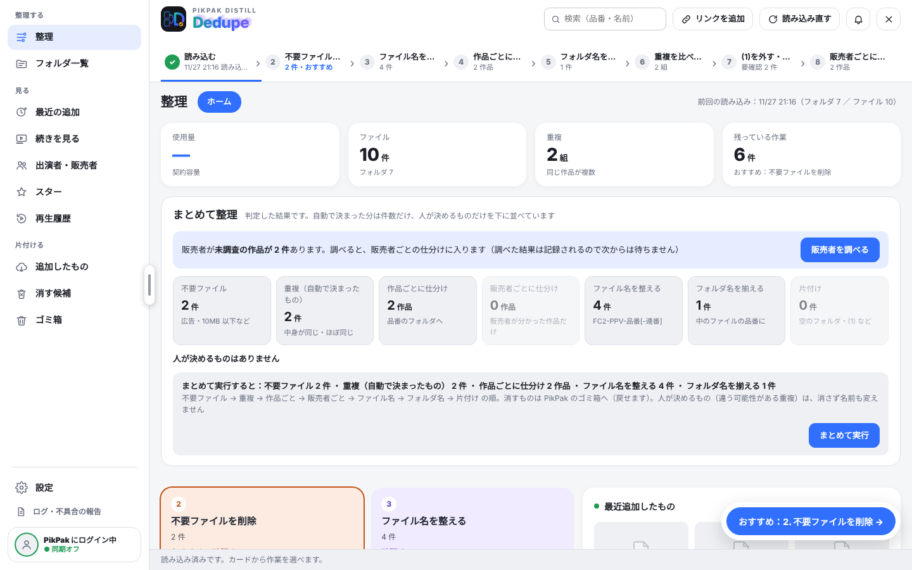
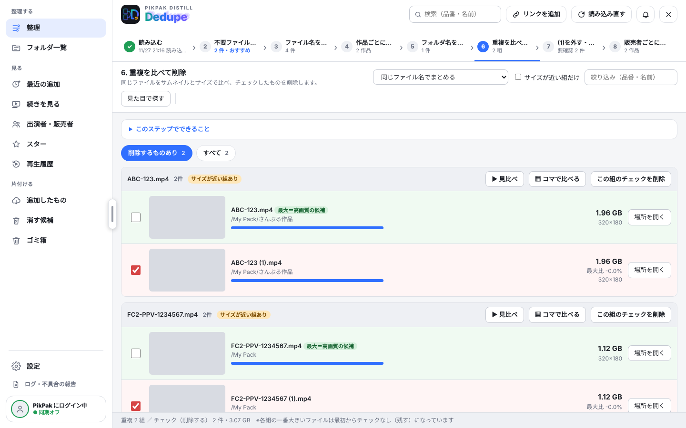
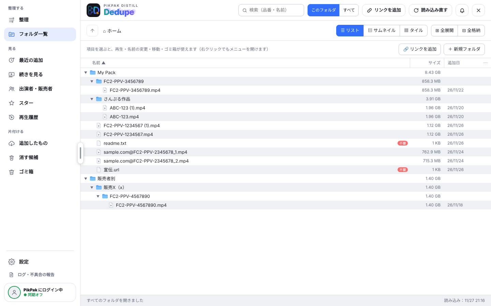

<p align="center">
  
</p>

<h1 align="center">PikPak Distill – Dedupe</h1>

<p align="center">
  PikPak のファイル整理・重複整理を助けるツール<br>
  （ブラウザのユーザースクリプト／Mac アプリ）<br>
  <sub>by Noel Labs</sub>
</p>

<p align="center">
  <a href="https://raw.githubusercontent.com/Noel-Labs39/pikpak-distill/main/pikpak-distill.user.js"><b>▶ インストール</b></a>
  ・
  <a href="LICENSE">MIT License</a>
</p>

| 整理 | 重複を比べて削除 | フォルダ一覧 |
| --- | --- | --- |
|  |  |  |

<sub>画面はサンプルのファイル名で作ったテスト用の画面です。</sub>

## これは何か

[PikPak](https://mypikpak.com/) のクラウドに貯まったファイルを、ブラウザの上で整理するためのツールです。PikPak の画面に「Dedupe」ボタンを足し、次のことができるようにします。

- **重複を見つけて消す**：同じファイル（同じ名前・同じ中身）をまとめて、サムネイルとサイズで見比べて消せます。いちばん大きいものを残す側として選んでおきます
- **散らかったフォルダを整える**：広告などの不要なファイルの削除、ファイル名・フォルダ名のそろえ直し、空のフォルダや `(1)` の片付け
- **見る**：Finder やエクスプローラーのようなフォルダ一覧、検索、簡易プレーヤー、最近の追加・続きを見る・ゴミ箱

消すものは PikPak のゴミ箱に入るので、あとから戻せます。

PikPak を長く使っている人向けの、少しニッチな機能もあります（リンクの追加前に「もうあるか」を確かめる、まとめて解凍する、作品の情報を調べて販売者ごとに分ける、など）。使えば分かるように、画面の中で次にやることを示しています。

## インストール

1. ブラウザに [Tampermonkey](https://www.tampermonkey.net/) を入れます（Chrome / Brave / Edge / Firefox など）。
2. 上の **▶ インストール** を開き、Tampermonkey の画面で「インストール」を押します。
3. 以後、新しい版が出ると Tampermonkey が自動で更新します。

### Mac アプリ版

PikPak の画面をアプリの中で開き、Dedupe を組み込んだ Mac 用アプリです。スクリプトは起動のたびに最新版を読み込みます。

1. [最新のリリース](https://github.com/Noel-Labs39/pikpak-distill/releases/latest) から `Dedupe-macOS.zip` をダウンロードして展開し、`Dedupe.app` をアプリケーションフォルダに入れます
2. 初回は「開けません」と出るので「完了」で閉じ、「システム設定」→「プライバシーとセキュリティ」の「このまま開く」を押します（Apple の公証を受けていないため）
3. 開けないときは、ターミナルで次を実行してから開きます

```
xattr -dr com.apple.quarantine /Applications/Dedupe.app
```

## 使い方

1. PikPak にログインし、右下（または左メニューの空き）の **Dedupe** ボタンを押します。
2. 左のメニューの **整理** で、まず読み込みます。整理できるものが件数付きで並ぶので、そのまま実行するか、1 つずつ中身を確かめてから実行します。
3. **フォルダ一覧** や **最近の追加** などで、ファイルを見たり再生したりできます。上のバーの検索は、どの画面からでも使えます。

細かい設定（テーマ・表示言語・再生のしかた・PikPak での同期など）は、左のメニューの **設定** にあります。

## 表示言語

日本語と英語に対応しています。ブラウザの言語に合わせて切り替わり、設定でも変えられます。

Japanese and English are supported. The language follows your browser and can be changed in Settings.

## 動作環境

- PikPak Web（`https://mypikpak.com/`）
- 標準の画面、[PikPak Enhancement Master](https://github.com/digbug82/PikPak_Enhancement_Master) の画面のどちらでも動作します（併用可）

## 注意事項

- 認証には、ログイン中の PikPak の画面がブラウザに保存している情報を使います。認証情報を外部へ送ることはありません。
- 実行する直前に最新の状態を確かめ、名前や場所が想定と違うときは止めます。
- 完全削除（ゴミ箱を経由しない削除）は元に戻せません。
- 本ツールは PikPak の非公式ツールです。PikPak の仕様が変わると動かなくなることがあります。
- 本ツールの利用によって生じたいかなる損害についても、作者は責任を負いません（MIT License）。

## ライセンス

[MIT](LICENSE) © 2026 Noel Labs
